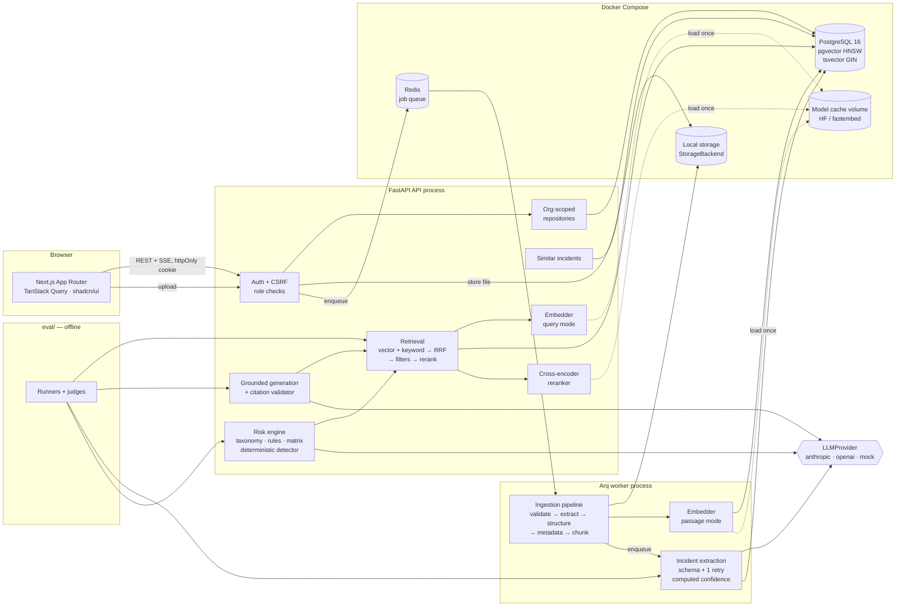

# SafeOps Intelligence — Phase 0 Plan

This document holds the Phase 0 outputs: repo layout, architecture, dependencies, phase plan, and risks and assumptions. The spec is in [MASTER_PROMPT.md](MASTER_PROMPT.md). Decisions are recorded in [DECISIONS.md](DECISIONS.md).

---

## 1. Environment audit (2026-11-22)

| Tool | Found | Needed | Status |
|---|---|---|---|
| Git | 2.45.1 | any recent | OK |
| Python | 3.14.3 (default), 3.12 also installed | 3.12 | OK. Backend pins 3.12 via `uv` |
| uv | not installed | yes | **Missing** |
| Node | 24.13.0 | 20+ | OK |
| npm / pnpm | 11.9.0 / 12.21.0 | one of them | OK (pnpm chosen) |
| Docker CLI | 29.7.2, Compose v5.5.1 | yes | OK |
| Docker daemon | 29.7.2, 4 CPUs, ~3.8 GB RAM (re-checked after Desktop started) | running | OK. Host port 5432 is taken by a native Postgres, so compose uses 5433 (ADR-010) |
| GNU make | not installed | yes (spec's Makefile) | **Missing** |
| gh CLI | `gh --version` hangs | for auth check | **Could not verify** |

**Git state:** `c:\Users\SPENCER\SafeOps` is **not a Git repository**. It has no `.git`, no `origin` and no `main` branch. The spec assumes this folder is a clone of an existing GitHub repo. This must be fixed before the first commit (see PROGRESS.md, "Blockers").

**Repo contents before Phase 0:** only `SafeOps_Master_Prompt.md`.

---

## 2. Proposed repository layout

```
SafeOps/
├── CLAUDE.md                  session rules
├── PROGRESS.md                running status (resume point for new sessions)
├── README.md                  (Phase 9: results table, quickstart)
├── Makefile                   dev, test, seed, download-models, eval, eval-fast, e2e, lint, reembed
├── docker-compose.yml         postgres(pgvector), redis, api, worker, model-cache volume
├── .env.example  .gitignore  .gitattributes
├── .github/workflows/ci.yml   lint, type-check, tests, eval-fast
│
├── docs/
│   ├── MASTER_PROMPT.md       spec (not rewritten unless asked)
│   ├── PLAN.md                this file
│   ├── DECISIONS.md           ADR log
│   ├── ERD.md                 (Phase 2, needs sign-off before the first migration)
│   └── ARCHITECTURE.md        (Phase 9)
│
├── backend/
│   ├── pyproject.toml  uv.lock  .python-version  Dockerfile  alembic.ini
│   ├── alembic/versions/
│   ├── app/
│   │   ├── main.py            FastAPI app factory, middleware, routers
│   │   ├── config.py          pydantic-settings, all env vars in one place
│   │   ├── logging.py         JSON logs + request-ID contextvar
│   │   ├── api/               routers: health, auth, documents, chat, incidents, jobs, risk, analytics
│   │   ├── core/              security (argon2, JWT, CSRF), deps, roles
│   │   ├── db/                session, models/, repositories/ (the org-scoped data-access layer)
│   │   ├── schemas/           Pydantic request/response models
│   │   ├── llm/               LLMProvider interface + anthropic / openai / mock + usage & cost
│   │   ├── embeddings/        EmbeddingProvider interface + local fastembed implementation
│   │   ├── storage/           StorageBackend interface + local filesystem
│   │   ├── ingestion/         validate, extractors/{pdf,docx,csv,txt}, structure, metadata, chunker, pipeline
│   │   ├── retrieval/         vector, keyword, fusion (RRF), rerank, filters, glossary.yaml, service
│   │   ├── generation/        prompts/, context builder, citation validator, answer service
│   │   ├── extraction/        incident schema, extractor (+1 repair retry), confidence calculator
│   │   ├── risk/              seed/*.yaml, taxonomy, rules, matrix, detector, analysis pipeline
│   │   ├── similarity/        similar-incident scoring + explanations
│   │   └── worker/            Arq settings + tasks (ingest, extract, reembed)
│   └── tests/                 unit/, integration/ (incl. tenant isolation), fixtures/
│
├── frontend/
│   ├── package.json  next.config.ts  tsconfig.json (strict)  vitest.config.ts  playwright.config.ts
│   ├── src/app/               (auth)/login,register · (app)/overview, assistant, documents,
│   │                          incidents, jobs, risk-rules, analytics, settings
│   ├── src/components/        ui/ (shadcn), layout/, feature components
│   ├── src/lib/api/           generated OpenAPI types + typed client, SSE reader
│   └── e2e/                   Playwright happy path
│
├── eval/
│   ├── retrieval_cases.jsonl  risk_cases.jsonl
│   ├── runners/               retrieval, grounding, citations, refusal, extraction, risk
│   ├── judges/                rubric prompts for the LLM judge
│   └── results/               raw runs (ignored) + published/ (committed, backs README)
│
├── data/synthetic/            generated reports (PDF/DOCX/TXT), CSV logs, procedures,
│   └── ground_truth/          permits, JSAs · incidents.jsonl
│
└── scripts/                   generate_synthetic.py, render_eval_table.py, download_models.py
```

**Why this shape:** each AI concern (ingestion, retrieval, generation, extraction, risk) has its own package. Each can be unit-tested and evaluated on its own, and each maps to one interview story. All database access goes through `db/repositories/`, so `org_id` scoping is written once.

---

## 3. Architecture



**Key flows**

1. **Ingest:** upload → API validates (magic bytes, size) → stores under a generated key → enqueues → worker extracts, chunks, embeds and indexes → status `ready`/`failed`.
2. **Ask:** question → rewrite/expand → vector + keyword (org-scoped inside SQL) → RRF → filters → rerank → top 8 in delimited blocks → LLM streams over SSE → citations validated deterministically → stored with token usage.
3. **Assess a job:** normalize activities → single-activity hazards → interaction rules (zone/time) → evidence retrieval per finding → LLM writes explanations only → matrix scoring → human review → audit log.

The LLM never decides *whether* a risk exists for rule findings, and never sets confidence or residual risk.

---

## 4. Dependencies

Versions are pinned in lockfiles when each phase adds them. A package is added only in the phase that needs it.

### Backend (Python 3.12, managed by `uv`)
| Package | Why |
|---|---|
| fastapi | API framework with OpenAPI generation (drives the typed frontend client) |
| uvicorn[standard] | ASGI server |
| pydantic v2, pydantic-settings | Typed schemas; typed env config in one place |
| sqlalchemy 2.x (async) + asyncpg | Typed ORM/query building; fast async Postgres driver |
| alembic | Schema migrations |
| pgvector (python) | SQLAlchemy `Vector` column type and distance operators |
| arq + redis | Lightweight async background jobs (spec choice) |
| argon2-cffi | Password hashing (spec requires argon2) |
| pyjwt | Sign/verify the session JWT |
| python-multipart | Needed by FastAPI for file uploads |
| structlog | JSON logs with request-ID context. Simpler than hand-rolled stdlib formatters |
| fastembed | Local ONNX embeddings **and** cross-encoder reranking, without PyTorch (see ADR-002) |
| pymupdf | PDF text with page numbers and font sizes (heading heuristic); also writes synthetic PDFs |
| python-docx | DOCX text with heading styles; also writes synthetic DOCX |
| charset-normalizer | Encoding detection for TXT/CSV |
| pyyaml | Taxonomy, rules, glossary seeds |
| anthropic, openai | Official SDKs for the two real LLM adapters |
| *(dev)* pytest, pytest-asyncio, httpx | Tests and the async API test client |
| *(dev)* ruff, mypy | Lint/format and static typing |

Deliberately **not** added: pandas (stdlib `csv` is enough), python-magic (libmagic is painful on Windows; four formats can be checked by hand), reportlab (PyMuPDF writes PDFs), LangChain/LlamaIndex (hides exactly the retrieval logic this project needs to show).

Possibly needed later (decided in Phase 3): an optional `eval-models` group (e.g. sentence-transformers) **only if** bge-m3 can't run through fastembed for the model comparison.

### Frontend (Next.js, pnpm)
| Package | Why |
|---|---|
| next, react, react-dom, typescript | Spec stack; App Router; strict TS |
| tailwindcss + shadcn/ui (Radix primitives, lucide-react) | Accessible components we own as source; restrained styling |
| @tanstack/react-query | Server state, polling of document status |
| openapi-typescript + openapi-fetch | Types generated from FastAPI's spec, and a tiny typed fetch client |
| recharts | The 3–4 analytics charts |
| react-markdown + rehype-sanitize | Sanitized markdown rendering of model output (no raw HTML) |
| react-hook-form + zod | Job-assessment stepper validation |
| *(dev)* vitest, @testing-library/react, jsdom | Component tests |
| *(dev)* @playwright/test | One end-to-end happy path |
| *(dev)* eslint (next config) | Lint |

SSE is read with `fetch` + `ReadableStream` (a small typed parser), not `EventSource`. `EventSource` can't POST a body or send the CSRF header.

### Infrastructure
`pgvector/pgvector:pg16` image, `redis:7-alpine`, a named volume for the model cache, and GitHub Actions with Postgres and Redis service containers.

---

## 5. Phase plan

| Phase | Goal | Decision points 🔶 | Exit check |
|---|---|---|---|
| 0 | Inspect, plan, scaffolding docs | — | This report approved |
| 1 | Foundation: compose, FastAPI `/health`, Arq skeleton, Alembic, auth + roles, org scoping, logging, Next.js shell, Makefile, CI | Frontend↔API wiring (direct CORS vs Next rewrite proxy) | `make dev` runs; auth + first isolation test pass; CI green |
| 2 | Synthetic data + ingestion + Documents page | **Embedding model**, **ERD** | All synthetic files ingest; extractor + chunker tests (incl. 512-token limit); failure reasons shown |
| 3 | Retrieval (vector, keyword, RRF, filters, rerank, glossary) + eval harness | Default reranker | Baseline retrieval numbers in PROGRESS.md |
| 4 | HSE Assistant: SSE chat, citations, refusal, feedback, UI + evals | — | Works on real provider and mock; injection doc has no effect; numbers recorded |
| 5 | Incident extraction + library + review + similar incidents | — | Per-field accuracy reported; corrections keep the original |
| 6 | Risk engine: taxonomy, rules, matrix, detector + traps | — | Precision/recall per rule; zero trap false positives |
| 7 | Pre-job analysis stepper, pipeline, review, audit, Playwright | — | Full flow works; review in audit log |
| 8 | Overview + analytics + UI polish | — | Chart numbers match SQL test queries |
| 9 | Full eval, Claude vs OpenAI, README, ARCHITECTURE.md, demo script, secret scan | — | Fresh clone runs from README alone |
| 10 | Stretch, one at a time, by request | — | — |

---

## 6. Risks and assumptions

### Risks
| # | Risk | Impact | Mitigation |
|---|---|---|---|
| 1 | Folder isn't a Git repo; `gh` hangs | Can't commit/push per spec | You fix or confirm the setup (see Blockers). I won't touch auth |
| 2 | Docker daemon not responding | Phase 1 can't run Postgres/Redis | Start Docker Desktop; re-check before Phase 1 |
| 3 | No `make` on Windows | Spec's Makefile commands won't run locally | Install GNU make (ADR-007, pending your choice); CI on Linux is unaffected |
| 4 | Python 3.14 is the default interpreter | Some wheels (PyMuPDF, asyncpg, fastembed/onnxruntime) may lag | Pin 3.12 with `uv` + `.python-version`; containers use 3.12 |
| 5 | CPU-only model inference | bge-reranker-base (~1 GB) and bge-m3 (~2 GB) are slow and memory-heavy in Docker Desktop | Default reranker MiniLM-L-6 (~90 MB); run bge-m3 only in the eval, offline; reranker loaded only in the API, embedder in both |
| 6 | Revision pinning may not be supported by fastembed | Eval results can't name exact weights | Verify in Phase 2; if unsupported, record the model file SHA-256 in each eval result |
| 7 | Synthetic data generated from templates is "too easy" | Inflated retrieval scores | Paraphrased questions, a jargon-heavy subset, distractor docs, messy cases; state the caveat in the README |
| 8 | Arq gets little active development | Possible maintenance gaps | Worker tasks sit behind thin functions; swapping to another queue would be contained. Keep for now (spec choice) |
| 9 | SSE buffering through proxies (e.g. Next.js rewrites) | Chat doesn't stream | Decide wiring in Phase 1; send `Cache-Control: no-transform`, test streaming early |
| 10 | Windows line endings | Broken shell scripts in containers | `.gitattributes` forces LF (done) |
| 11 | LLM cost during evals | Spend creep | Fast model for judging/extraction, `eval-fast` on mock in CI, usage logged per call, full runs only when asked |

### Assumptions
- One developer, local dev on this Windows machine; CI and containers on Linux.
- No API keys are needed until Phase 4. Everything before that runs on the `mock` provider.
- You'll supply Anthropic and OpenAI keys (in `.env` only) by Phase 4, and both by Phase 9 for the comparison.
- "Keyword search" means Postgres full-text search, never called BM25.
- The repo stays private until the Phase 9 history scan passes.
